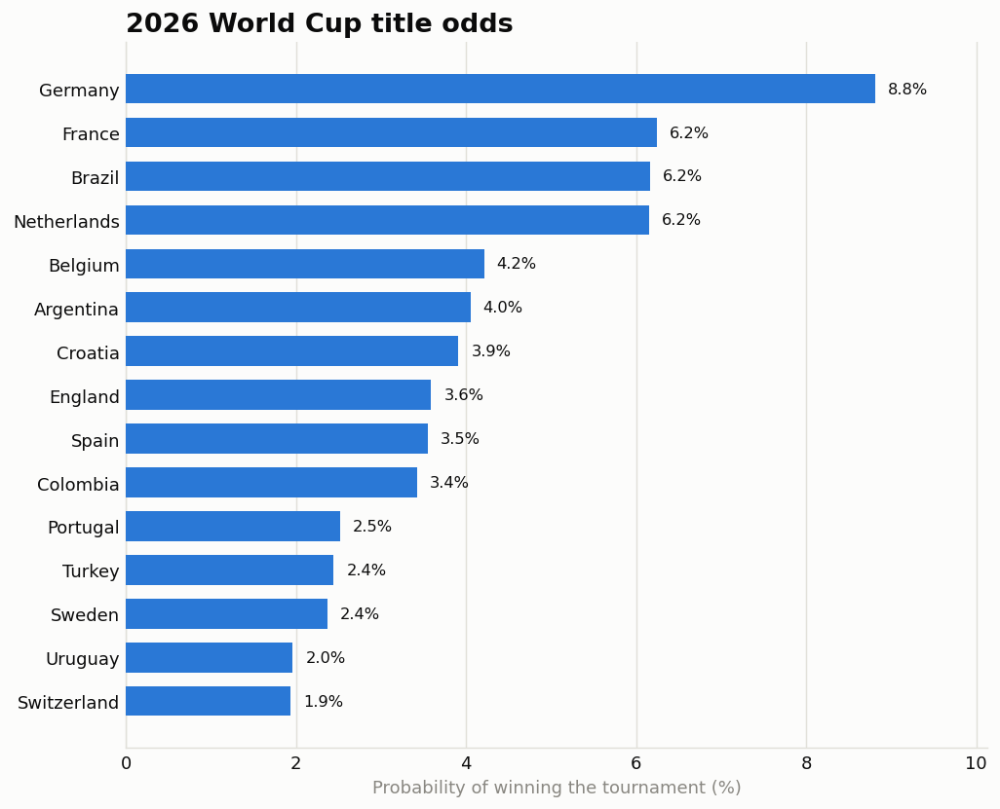
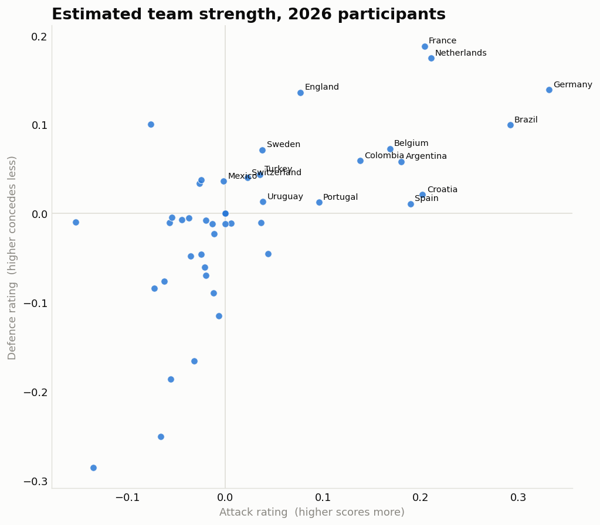
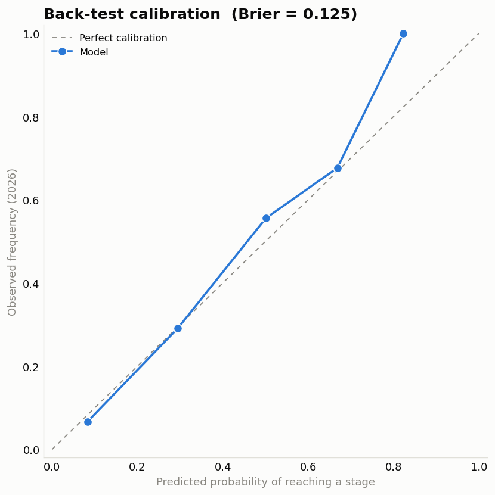

# FIFA World Cup 2026 Predictor


A statistical predictor for the 2026 FIFA World Cup. Each team is given an
attack and a defence rating estimated jointly from a century of World Cup
results with a **time-weighted, ridge-regularised Dixon-Coles goal model**, and
the 48-team tournament is played out thousands of times by **Monte Carlo
simulation** to turn those ratings into probabilities.

*(Español más abajo — [ir a la versión en español](#predictor-del-mundial-2026).)*

<p align="center">
  
</p>

## Why this model

The usual beginner approach ("a team's strength is its average goals scored
times the opponent's average goals conceded") is easy but weak: it weights a
1930 match like a 2018 one, can't tell a good result against a strong side from
a flattering one against a weak side, and eliminates debutant nations by
construction. This project replaces it with the model used in the football
analytics literature:

- **Dixon-Coles goal model.** For a match between home team *i* and away team *j*
  the goal rates are `λ = exp(home + attackᵢ − defenceⱼ)` and
  `μ = exp(attackⱼ − defenceᵢ)`, and a low-score correction `τ` fixes the
  0-0 / 1-0 / 0-1 / 1-1 results that an independent double-Poisson gets wrong.
- **Time decay.** Matches are weighted by `exp(−ξ · age)` so recent tournaments
  count more (a ~14-year half-life by default).
- **Ridge regularisation.** World Cup teams have wildly uneven match counts;
  an L2 penalty shrinks poorly-observed sides toward the average so minnows with
  one lucky result don't top the ratings.
- **Joint maximum-likelihood fit** with `scipy.optimize` (attack ratings
  constrained to sum to zero for identifiability) — no `statsmodels` dependency.
- **Monte Carlo bracket.** 12 groups of 4, FIFA tie-breakers, the 8 best
  third-placed teams, and the official round-of-32 bracket template played
  through to the final, repeated 10,000 times.

The estimated ratings recover a credible pecking order (Germany, France, Brazil,
the Netherlands, Belgium, Argentina, …) rather than the small-sample noise a
naïve fit produces.

<p align="center">
  
  
</p>

## Back-test

The 2026 tournament has already been played, so the predictions can be checked
against reality. Pooling every *(team, stage)* prediction — the probability each
side reaches the round of 32, 16, quarters, semis and final — the model is
**well calibrated** (points sit close to the diagonal, Brier ≈ 0.12). The model's
pre-tournament favourite was Germany; the real 2026 final was contested by Spain
and Argentina, both among the model's top nine — a reminder that a single
tournament is high-variance, which is exactly why the output is a probability
distribution rather than a single bracket.

## Project structure

```
src/worldcup/        Reusable package
  config.py            Paths, tournament format, bracket template
  scraping.py          Wikipedia scrapers (historical results, 2026 groups/bracket)
  cleaning.py          Score parsing, team-name normalisation, successor states
  model.py             Dixon-Coles model + maximum-likelihood fit
  simulation.py        Monte Carlo tournament simulation and back-test helpers
scripts/             Pipeline entry points (01 scrape → 02 clean → 03 fit → 04 simulate)
notebooks/           worldcup_2026_showcase.ipynb — the narrative walk-through
tests/               pytest suite
data/                raw/ (versioned snapshots) and processed/ (regenerated)
reports/figures/     Generated charts
```

## Quickstart

```bash
python -m venv .venv && source .venv/bin/activate   # Windows: .venv\Scripts\activate
pip install -r requirements.txt

python scripts/01_scrape_data.py          # scrape 2026 groups + results into data/raw
python scripts/02_build_dataset.py        # clean into data/processed
python scripts/03_fit_model.py            # fit the Dixon-Coles model
python scripts/04_simulate_tournament.py  # simulate, back-test and draw figures

pytest                                    # run the test suite
```

The historical training set (1930–2018) ships as a versioned snapshot in
`data/raw`, so step 01 only needs the network for the 2026 data. Pass
`--refresh-historical` to re-scrape it.

## Modelling choices worth knowing

- **Successor states.** West Germany's record is folded into Germany,
  Czechoslovakia's into the Czech Republic, and Zaire's into DR Congo, so a
  modern side inherits its full World Cup history.
- **Debutants** (Cape Verde, Curaçao, Jordan, Uzbekistan, …) have no history, so
  they take league-average ratings — competitive but not favoured — instead of
  being unbeatable-or-hopeless.
- **Neutral venues.** Knockout ties are decided by a strength-weighted coin flip
  standing in for a penalty shootout.

## Limitations

Training data ends in 2018 (recent World Cup articles split match results across
sub-pages with inconsistent markup); squad, injury and form information is
ignored; and all venues are treated as neutral. Blending in continental
qualifiers and using the FIFA ranking as a prior for debutants are natural next
steps.

## License

MIT — see [LICENSE](LICENSE).

---

# Predictor del Mundial 2026

Un predictor estadístico para el Mundial de Fútbol 2026. A cada selección se le
estiman una fuerza ofensiva y una defensiva de forma conjunta, a partir de un
siglo de resultados mundialistas, con un **modelo de goles Dixon-Coles ponderado
en el tiempo y regularizado (ridge)**; después se simula el torneo de 48
equipos miles de veces mediante **simulación de Monte Carlo** para convertir
esas fuerzas en probabilidades.

## Por qué este modelo

El enfoque habitual de tutorial ("la fuerza de un equipo es su media de goles
marcados por la media de goles encajados del rival") es sencillo pero débil:
pesa igual un partido de 1930 que uno de 2018, no distingue un buen resultado
ante un rival fuerte de uno halagador ante uno débil, y elimina por
construcción a las selecciones debutantes. Aquí se sustituye por el modelo
estándar en la analítica de fútbol:

- **Modelo Dixon-Coles.** Tasas de goles `λ = exp(local + ataqueᵢ − defensaⱼ)` y
  `μ = exp(ataqueⱼ − defensaᵢ)`, con una corrección `τ` para los marcadores
  bajos (0-0, 1-0, 0-1, 1-1) que el doble Poisson independiente estima mal.
- **Decaimiento temporal.** Los partidos se ponderan por `exp(−ξ · antigüedad)`,
  dando más peso a los mundiales recientes (vida media ~14 años por defecto).
- **Regularización ridge.** Los equipos tienen recuentos de partidos muy
  dispares; una penalización L2 encoge hacia la media a los poco observados,
  para que una "cenicienta" con un resultado afortunado no lidere el ranking.
- **Ajuste conjunto por máxima verosimilitud** con `scipy.optimize` (ataques con
  suma cero por identificabilidad) — sin depender de `statsmodels`.
- **Bracket Monte Carlo.** 12 grupos de 4, desempates FIFA, los 8 mejores
  terceros y la plantilla oficial de dieciseisavos hasta la final, repetido
  10.000 veces.

## Validación (backtest)

Como el Mundial 2026 ya se jugó, las predicciones se contrastan con la realidad.
Agrupando cada predicción *(equipo, ronda)*, el modelo está **bien calibrado**
(Brier ≈ 0,12). Su favorito previo era Alemania; la final real la disputaron
España y Argentina, ambas entre las nueve primeras del modelo — un recordatorio
de que un solo torneo tiene mucha varianza, y por eso la salida es una
distribución de probabilidad y no un único cuadro.

## Estructura y ejecución

La lógica reutilizable vive en el paquete `src/worldcup`; los `scripts/`
numerados ejecutan el pipeline (01 scraping → 02 limpieza → 03 ajuste → 04
simulación) y `notebooks/worldcup_2026_showcase.ipynb` es el recorrido narrado.

```bash
pip install -r requirements.txt
python scripts/01_scrape_data.py
python scripts/02_build_dataset.py
python scripts/03_fit_model.py
python scripts/04_simulate_tournament.py
pytest
```

## Limitaciones

Los datos de entrenamiento llegan hasta 2018 (las páginas recientes reparten los
partidos en subpáginas con marcado inconsistente); no se usa información de
plantillas, lesiones ni estado de forma, y todas las sedes se tratan como
neutrales. Incorporar las clasificatorias continentales y usar el ranking FIFA
como *prior* para las debutantes son los siguientes pasos naturales.

## Licencia

MIT — ver [LICENSE](LICENSE).
